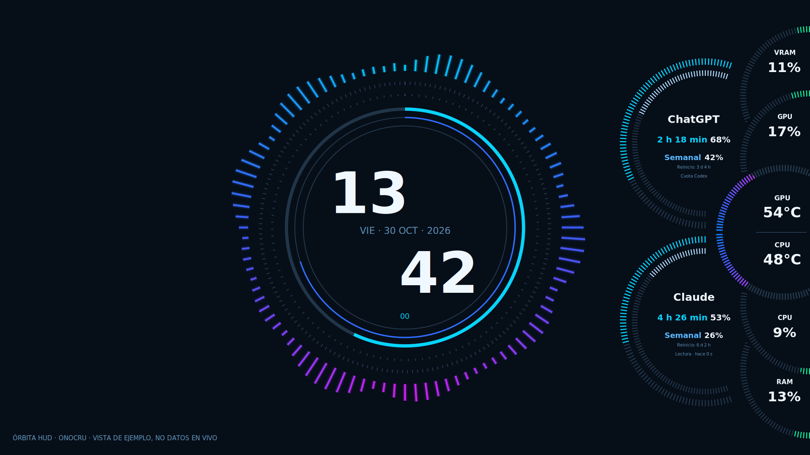

# Órbita HUD

**Un reloj, el sonido de tu equipo y tus indicadores en órbita.** Un tema para Conky creado por **Onocru**, con reloj digital central, espectro de audio circular y panel lateral reversible.



[Prueba visual con todos los medidores al 50% del recorrido visible](assets/progress-50.png).

Versión **0.1.5**, probada en Linux Mint 22.3 Cinnamon, sesión X11 y Conky 1.19.6. El panel es transparente: el fondo de esta captura es ilustrativo. [Cambios de esta versión](CHANGELOG.md).

## Qué incluye

- Reloj de 24 horas con fecha y año en español; cinco anillos de avance continuo: segundos, minutos, horas, semana (7 segmentos, lunes a domingo) y año (12 segmentos, uno por mes y con su duración real).
- Halo de 128 bandas que reacciona al **sonido de salida** de la computadora: música, juegos, videos o cualquier aplicación. Sigue la salida predeterminada y no escucha el micrófono. En silencio se atenúa.
- GPU arriba: temperatura, carga global y VRAM utilizada. CPU abajo: temperatura, carga global y RAM general utilizada.
- Dos arcos por suscripción: ventana corta y semana, con porcentaje usado y cuenta regresiva al reinicio real. Sin barras horizontales. Si el proveedor confirma 0% y no hay un reinicio activo, muestra «Sin iniciar · 0%».
- Dos módulos independientes en Conky Manager 2: `conkyrc-clock` y `conkyrc-panel`.
- Escala proporcional al área útil del monitor principal, conservando círculos redondos y descontando el menú/panel del escritorio. El panel lateral se puede colocar a izquierda o derecha y se reajusta automáticamente cuando cambia el espacio disponible.

## Instalación

[Descargar código e instalador en ZIP](https://github.com/Mike7Gtz/orbita-hud/archive/refs/heads/master.zip). Extrae el ZIP y ejecuta `./install.sh` desde su carpeta, o clona el repositorio con los comandos siguientes.

Dependencias en Mint/Ubuntu (paquetes de sus repositorios oficiales):

```bash
sudo apt update
sudo apt install conky-all python3 python3-numpy pulseaudio-utils x11-xserver-utils x11-utils libglib2.0-bin fonts-dejavu-core git
git clone https://github.com/Mike7Gtz/orbita-hud.git
cd orbita-hud
./install.sh
python3 ~/.conky/Orbita-HUD/runner.py start
```

El instalador no necesita sudo. Copia el tema a `~/.conky/Orbita-HUD`, preserva la configuración personal y respalda una instalación anterior del tema. No detiene otros Conkys. Requiere Python 3.11 o superior y Conky con soporte Lua/Cairo.

En Conky Manager 2 pulsa **Refresh** y activa los dos archivos. También funcionan por separado. No actives simultáneamente copias del mismo módulo. Para iniciar al entrar a Cinnamon:

```bash
./install.sh --autostart
```

El arranque automático es opcional. Si Conky Manager ya inicia estos módulos, usa solamente ese mecanismo. Para detener exclusivamente esta instalación:

```bash
python3 ~/.conky/Orbita-HUD/runner.py stop
```

## Ajustes

Edita `~/.config/orbita-hud/config.toml` y reinicia los módulos. `config.example.toml` contiene las opciones y sus comentarios.

```toml
[appearance]
side = "left"       # o "right"
monitor = "HDMI-0"  # vacío selecciona el principal
clock_scale = 0.82
top_margin = 18
bottom_margin = 18
fps = 25

[audio]
enabled = true
gain = 1.0
```

El panel obtiene el área útil de cada monitor con `org.Cinnamon.GetMonitorWorkRect` y usa `_NET_WORKAREA` como respaldo fuera de Cinnamon. Los márgenes se añaden **después** de descontar las reservas del escritorio. Su ancho y alto escalan juntos; reproducir un video no cambia el tamaño. El muestreador revisa la geometría cada 3 segundos y, si cambia, reinicia únicamente el módulo lateral que esté activo. No activa un módulo que hayas desmarcado.

Se conserva el tamaño y la posición del reloj central. Si eliges otra pantalla para el conjunto desde el archivo de configuración, ejecuta de nuevo `runner.py start`. La geometría está pensada para pantallas de escritorio de al menos 1280×720. Las letras permanecen legibles al reflejar el panel. La posición y el tamaño se gestionan con este archivo; las dimensiones de respaldo del editor de Conky Manager no sustituyen el ajuste automático.

Los medidores laterales forman una composición de **círculos entrelazados**: VRAM pasa detrás de la carga GPU, RAM detrás de la carga CPU, y el aro térmico GPU/CPU queda por delante de ambos. Los trazos que continúan detrás se recortan con máscaras transparentes; no se pintan discos sobre el fondo de pantalla. Los dos aros de cuota conservan la silueta de la referencia y las etiquetas coloreadas. Los textos tienen una zona legible incluso al mostrar `100%`, y mantienen su orden de lectura al reflejar el conjunto.

Un dock que no reserve espacio en el gestor de ventanas (por ejemplo, con ocultamiento automático) no se descuenta artificialmente; sí se respetan los paneles que reservan área de trabajo.

## Límites de las suscripciones: alcance real

**ChatGPT / Codex:** el proveedor usa la sesión de tu CLI oficial `codex` y el método de solo lectura `account/rateLimits/read` del [App Server documentado por OpenAI](https://learn.chatgpt.com/docs/app-server). No envía mensajes a modelos ni consulta consumo facturado de la API. Lee las ventanas que devuelve el servicio y selecciona la cuota `codex`. La etiqueta secundaria **Cuota Codex** identifica ese alcance: **no mide los límites de mensajes de todos los modelos de chatgpt.com**. Requiere que ya tengas el CLI instalado e iniciado con tu suscripción. Si no está disponible, muestra `--`.

**Claude Code:** incluye un puente para la [línea de estado oficial](https://code.claude.com/docs/en/statusline). Se activa después de instalar el tema con `python3 ~/.conky/Orbita-HUD/runner.py connect-claude`. Prepara `~/.claude/usage-statusline.sh` y lo conecta desde `~/.claude/settings.json`, respaldando y conservando las demás preferencias. El script recibe JSON por stdin y escribe únicamente cuotas saneadas en `~/.claude/usage.json`. Requiere una primera respuesta con `rate_limits` en Claude Code usando una suscripción compatible. No obtiene lecturas de la web/app por sí solo. El visor muestra la antigüedad del dato y `--` hasta recibirlo o cuando caduca. [Contrato y limitaciones](docs/providers.md).

Los arcos representan **porcentaje utilizado**, de 0 a 100. El recorrido se calcula después de descontar las partes ocultas por otras circunferencias y por el borde de la pantalla: un 50% pinta la mitad de las secciones visibles. Una lectura ausente o con reinicio alcanzado se oculta: nunca se inventa un 0%. Una lectura semanal antigua se conserva hasta su reinicio conocido, con la indicación «Última lectura» y su antigüedad; no se presenta como una consulta reciente. Las lecturas caducan por defecto a los 15 minutos. La fila de sesión muestra el tiempo restante en lugar de una etiqueta estática de 5 h; la semanal también informa su reinicio. Los valores de las capturas son ejemplos y no se incluyen en los datos del tema.

## Sensores y privacidad

- NVIDIA: primera GPU informada por `nvidia-smi`. AMD: sensores DRM/hwmon cuando los expone el controlador. Otros controladores pueden devolver `--`. No se confunde un sensor NVMe con la CPU.
- CPU global: diferencia de contadores de `/proc/stat`. RAM: memoria total menos `MemAvailable`, incluyendo la memoria recuperable como disponible.
- Arcos térmicos: solo se colorea la fracción utilizada del recorrido visible, de azul hacia rojo para CPU y GPU. El rojo corresponde al máximo configurado o informado por el hardware (sensor crítico CPU / máximo operativo GPU). En NVIDIA se convierten los márgenes relativos `T.Limit` según su [documentación](https://docs.nvidia.com/deploy/nvidia-smi/index.html). Si no existe un límite, se usa la escala de respaldo de 100 °C; puedes indicar un valor verificado en `[temperature] cpu_max_c` / `gpu_max_c`. La escala es visual y no controla ventiladores ni límites térmicos.
- Procesamiento de audio local por FFT/NumPy, captura del monitor de salida con `parec`. **No se guardan grabaciones.**
- No se leen cookies ni archivos de tokens. Se conservan únicamente valores saneados en `$XDG_RUNTIME_DIR/orbita-hud` (o caché local si falta ese directorio). Nada se envía a un servidor de Órbita HUD.
- Un proceso de muestreo compartido evita lectores duplicados. Se cierra después de 60 segundos sin módulos activos. El panel se dibuja a 1 Hz; el reloj y su halo a 25 FPS por defecto.

## Desarrollo

```bash
python3 -m unittest discover -s tests -v
python3 scripts/check_lua.py
python3 scripts/preview.py assets/preview-right.png
python3 scripts/preview.py assets/preview-left.png --side left
python3 runner.py doctor
python3 scripts/package.py
```

La vista previa ejecuta **el mismo renderizador Lua/Cairo** del escritorio, con datos sintéticos marcados como ejemplo. No utiliza una imagen generada para simular que el tema está funcionando.

Licencia **GPL-3.0-or-later**. Autor: **Onocru** ([Mike7Gtz](https://github.com/Mike7Gtz)). Referencias, límites de reutilización y agradecimientos: [CREDITS.md](CREDITS.md).
